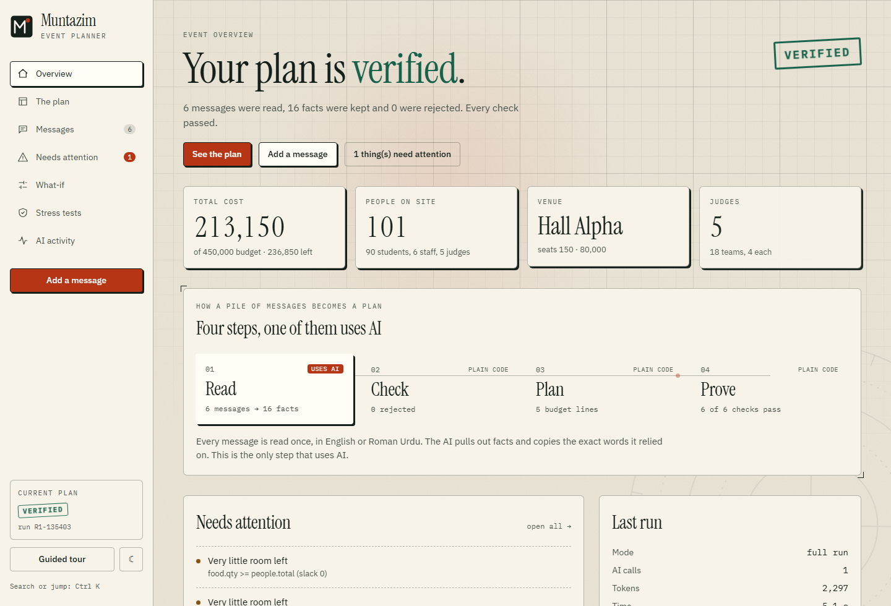
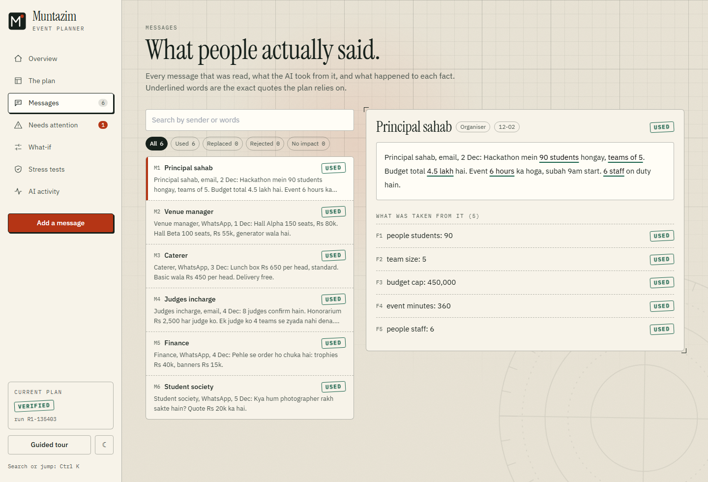
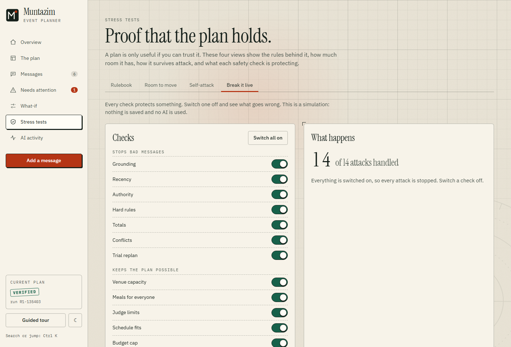
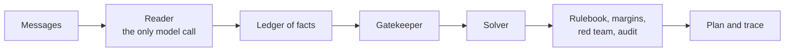

# Muntazim

**Turn a pile of messy event messages into one plan you can trust.**

Emails, WhatsApp texts and notices arrive in English and Roman Urdu. Prices change, some messages are wrong, and some come from people who have no authority to decide. Muntazim reads the pile and produces one event plan (venue, people, food, judging, schedule, budget), then proves the plan holds.

The idea: **treat messages like source code.** A language model is used for **reading only**. Everything after that is plain, deterministic code you can explain line by line.



<sub>Screenshots show a run on an invented Roman Urdu message set, not the event's own pack.</sub>

## What makes it different

| Step | Who does it | What it does |
|---|---|---|
| **Read** | the model (one call) | Turns messages into facts. Every fact carries the exact words it came from. |
| **Check** | plain code | Rejects facts that are ungrounded, stale, unauthorised, or that would make the plan impossible. Each rejection has a reason and a drafted reply. |
| **Plan** | plain code | A pure solver picks venue, food and judges, builds the schedule and the budget. Same facts in, same plan out. |
| **Prove** | plain code | Six audit checks recompute the figures independently. A red team attacks the checks. Margins show how far each input can move. |



## Quick start

```bash
pip install -r requirements.txt
```

Copy `.env.example` to `.env` and fill in your keys, model and allowlist. Then:

```bash
python run.py <path-to-txt>
```

- **No `state/` folder:** a full run. One model call, two when the code finds something missing.
- **`state/` exists:** the file holds new messages and the plan is updated. At most five calls.
- **Output:** a numbered trace in the terminal, plus `out/plan.md` and `out/trace.txt`.

`out/plan.md` holds the plan (venue, schedule, food, judging, budget against the cap) and one trace line per model call with its number, model, purpose and tokens, plus a total. `out/trace.txt` holds every call in full.

### Dashboard

```bash
python server.py
```

Open http://127.0.0.1:8000. You can paste messages on the **Add a message** page and press **Build the plan**. It runs exactly the same pipeline as the command line. The command line never needs the dashboard.

| Page | What it shows |
|---|---|
| Overview | The verdict, the key figures, the four steps, and what needs attention |
| The plan | Venue, people, food, judging, schedule and budget, each with its sources |
| Messages | Every message, what was taken from it, with the exact quote underlined |
| Needs attention | Rejected messages with the rule that blocked them and a drafted reply |
| What-if | Move an input and watch the plan change. Nothing is saved |
| Stress tests | The rulebook, margins, self-attack, and a switch for every check |
| AI activity | The numbered trace: model, purpose and tokens for every call |
| Add a message | Paste messages and rebuild the plan |



## How it works



**Gatekeeper, in order:** grounding (the quote is in the text and its numbers are recoverable), recency (older never beats newer), authority (a role may only set what it owns), hard rules, totals that must add up, conflicts, and a trial replan that rejects a change only if it makes a working plan impossible. A change that only costs more is accepted.

**Honest by design:** token counts come only from the API's own usage report. A constraint the system does not understand is kept visible as "unsupported" and never dropped silently. A missing required input fails the audit instead of being planned around.

## Layout

| Path | Role |
|---|---|
| `run.py` | Command line: read, check, plan, prove, save, print the trace |
| `core/reader.py` | The only module that calls the model |
| `core/gatekeeper.py` | Grounding, recency, authority, hard rules, totals, conflicts, trial replan |
| `core/solver.py` | The pure planner |
| `core/rules.py`, `margins.py`, `attack.py`, `audit.py` | Rulebook, breaking points, red team, six-check audit |
| `core/llm.py`, `core/trace.py` | Key rotation on one model, the numbered trace |
| `server.py`, `web/` | The dashboard (React, Tailwind, Framer Motion) |
| `docs/WHY.md` | Why each part exists, and answers to likely questions |
| `docs/OVERVIEW.md` | A plain-English overview with known weaknesses |

## Other commands

```bash
python attack.py       # red team against the saved state, no model calls
python preflight.py    # pre-test safety check, no model calls
```

`web/dist` is committed. You only need `npm install && npm run build` inside `web/` to change the dashboard.

## Dashboard endpoints

`GET /api/state`, `POST /api/whatif` and `POST /api/ablate` never write state. `POST /api/send` calls the model and changes the saved plan, so the dashboard labels it as a demo.

## Rules this repo follows

- No facts, values or names from the event's messages appear in source, prompts, tests or comments. `preflight.py` scans for leaks.
- `state/`, `out/`, `packs/`, `.env` and caches are git-ignored. `.env.example` is committed.
- Planner policy numbers are named constants with comments. They are not taken from any message set.

## Known limits

- The reader's output varies from run to run. The audit exists to catch a wrong plan, not to hide it.
- The red team tests the gatekeeper and solver. It does not test whether the reader missed or invented a fact.
- The solver assumes one venue, one food option and one meal. Multi-day events do not fit.
- When a message words a feature differently from the offer that provides it, a simple pairing rule links them, and it only works when exactly one need and one offer are left unmatched.

More in [docs/OVERVIEW.md](docs/OVERVIEW.md).
